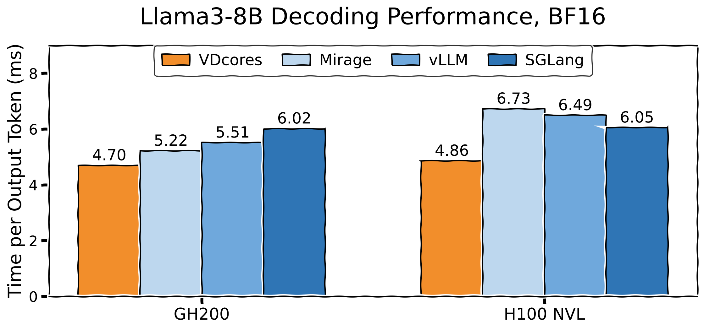

# VDCores

[](https://developer.nvidia.com/cuda-toolkit)
[](https://www.python.org/)
[](https://pytorch.org/)

VDCores is a research runtime and programming interface for modern asynchronous GPUs. It decouples GPU kernels into async executing memory and compute virtual cores and reconnects them through explicit dependencies.

Decoupling brings three key benefits:

**Asynchrony with Simplicity.** Kernel writers can focus on the computation logic while the runtime handles dynamic memory allocation, data movement, and dependency tracking under the hood. See a compact example in [`GEMV on VDCores`](include/task/gemv.cuh).

**Overlapping for free.** The VDCores runtime automatically exploits prefetching, overlap, and scheduling opportunities. Say goodbye to manually fusing stages or hand-engineering overlap for every single workload.

**Compose to adapt, on the fly.** Recompose VDCores memory, compute, and control blocks to explore schedules and swap execution plans. Adapt to changing resources or input batches by changing how VDCores instructions are connected.

Learn more about VDCores in our [paper](https://arxiv.org/abs/2605.03190) and
[blog post](https://mlsys.wuklab.io/posts/vdcores/).

## VDCores-Embedded Branch Roadmap

This section tracks the experimental work on the `anant/cpu-gpu-handoff` branch as of October 18, 2026. The goal is to extend VDCores from GPU-only virtual cores into a dependency-driven CPU–GPU runtime: work becomes eligible when its inputs are ready, and CPU/GPU-capable operations can be placed late using measured cost and current resource availability.

Checklist convention: checked items are complete within the scope stated. Unchecked items still need work. Coherent-attention experiments specifically require compatible GH200 hardware; the separate CUDA-event loop has now been tested on A100.

### Completed

- [x] Build a coherent CPU/GPU counter backed by a CPU-resident PyTorch tensor.
- [x] Use `std::atomic_ref` on the CPU and system-scope CUDA atomics on the GPU through a PyBind bridge.
- [x] Validate CPU-to-GPU, GPU-to-CPU, and round-trip signaling on GH200 hardware.
- [x] Integrate the signal into a real VDCores chain: split-attention completion → CPU dot product → CPU acknowledgement → GPU dot product → final completion.
- [x] Compare the integrated chain with a host-blocking baseline and save reproducible [results](results/cpu_gpu_handoff/2026-09-22-attention-chain.md). The handoff path reduced median latency from 3.389 ms to 2.847 ms in the recorded 1,000-iteration run, while preserving the benchmark's correctness checks.
- [x] Add unit coverage for placement, dependency scheduling, adaptive planning, and the embedded loop. All 48 focused tests pass on A100; local CPU-only runs pass 43 and skip the five real-CUDA cases.

The expanded reference-graph/camera suite now passes 69 focused tests on A100;
local runs pass 60 and skip nine real-CUDA cases. These tests do not establish
that the original Hopper VM runs on A100.

### Implemented, but not finished

- [x] Add a measured CPU/GPU [placement policy](python/dae/placement.py) that considers work size, estimated execution time, queue delay, deadlines, and a switch margin.
- [x] Add a backend-independent [reference scheduler](python/dae/heterogeneous.py) for dependency validation, ready/running/complete states, and fixed or flexible placement.
- [x] Add a same-operation CPU-versus-GPU [crossover benchmark](tests/script/check_attention_placement.py).
- [x] Add a calibration-driven [adaptive attention runner](tests/script/run_adaptive_attention_handoff.py) with an offline planning mode.
- [ ] **Hardware run pending:** measure the crossover curve on GH200/GB200-class coherent hardware and commit the raw JSON plus a readable summary.
- [ ] **Hardware run pending:** execute the adaptive chain at small, near-crossover, and large work sizes; verify correctness and compare its choice with both static CPU and static GPU placement.
- [ ] **Hardware run pending:** repeat the placement experiment under controlled CPU and GPU queue pressure and report median and tail latency.

The general scheduler is a Python reference/control model. The new native loop below advances a fixed graph directly, while arbitrary graph lowering remains unfinished.

### Embedded feedback loop: first executable prototype

- [x] Add persistent C++ CPU workers for a repeating sensor/preprocess → external feature reduction → controller → next-frame feedback graph.
- [x] Bound buffer use to one slot per independent loop and validate frame-tagged completion tokens before releasing dependent CPU work.
- [x] Add real CPU-reference execution and an independent numerical oracle for every frame's feature and feedback action.
- [x] Add cancellation, failure propagation, ownership checks, and standalone sanitizer stress tests.
- [x] Add and hardware-test an ordinary Torch CUDA adapter using pinned transfers, streams, and completion events, plus a matched blocking-service baseline, on A100-SXM4-80GB without building the Hopper extension.
- [x] Record [local CPU validation](results/embedded_loop/2026-10-18-local-validation.md): 3,300 correct feedback frames across one-loop and four-loop experiments, with raw per-frame records.
- [x] Execute both CUDA adapter modes on A100 and collect size, shared-loop, polling, and longer tail-latency experiments.
- [x] Execute CPU feature work on the persistent native worker pool and expose live queued/running counts for preprocessing, feature, and control work.
- [x] Calibrate native CPU versus GPU event-transport cost on the same host, integrate the measured policy into the running loop, and test held-out sizes against both fixed-device baselines.
- [x] Add linear cost interpolation for bandwidth-bound work after held-out tests exposed early GPU selection from the original log-size interpolation.
- [x] Produce a reproducible [figure gallery](results/embedded_loop/figures/README.md) with raw samples, trial spread, stage breakdowns, and clearly separated historical GH200 results.
- [x] Capture and hardware-test the fixed GPU stage with CUDA Graph replay to reduce repeated Python/driver submission work, retaining event-based buffer ownership.
- [ ] Reduce adaptive-selection overhead and improve queue estimates near the crossover; current adaptive execution can regress against the best fixed placement.
- [ ] Replace the synthetic reduction with a real embedded workload and integrate a compatible VDCores GPU launcher.

Build and run the portable validation:

```bash
python tools/build_embedded.py
python tests/script/run_embedded_loop.py --backend cpu --lanes 4 \
  --output results/embedded_loop/local-check.json
```

See the [reviewed implementation plan](agents/workflows/embedded-loop-plan.md) and [experiment workflow](agents/workflows/embedded-loop-experiments.md) for CUDA runs and measurements. This fixed-graph prototype uses synthetic sensor data; it does not yet lower arbitrary operations into the original VDCores GPU VM or implement coherent GH200 handoffs inside the new loop.

### A100 reference studies — not a VDCores port

The A100 is a reference/data-collection platform. **The original VDCores CUDA
runtime, kernels, instruction encoding, launcher, and Hopper build target remain
unchanged.** The added host-side experiments must not become a replacement
runtime or be described as measured VDCores GPU-VM benefits. Python stays in the
reference execution path intentionally; removing it is not the current priority.

- [x] Add executable reference task graphs with declared inputs, dependencies,
  CPU/GPU capabilities, branching/joining, and bounded feedback contexts.
- [x] Add a separate original-Launcher adapter contract and fake-Launcher tests;
  actual workload binding and Hopper hardware validation are still pending.
- [x] Add a camera-to-control reference workload using classical lane/obstacle
  processing, previous-command feedback, and an independent NumPy oracle.
- [x] Support user-provided RGB NPZ recordings. Current experiments use generated
  scenes, not validated real-world recordings, learned inference, or a robot.
- [x] Add matched CPU-only, serial GPU, ready-task GPU, and adaptive comparisons,
  with separate calibration/evaluation frames, trial ordering, CPU/GPU background
  load, periodic-arrival backlog, per-loop tails, throughput, and CPU-use reporting.
- [ ] Use the reference measurements to propose specific changes to actual
  VDCores; validate any performance claim on the real runtime later.
- [ ] Choose a representative application and evaluate recorded inputs/accuracy.
- [ ] Add optimized GPU-resident/fused and camera-stage CUDA Graph baselines
  before claiming an advantage over an optimized GPU implementation.

See the [reviewed reference plan](agents/workflows/embedded-graph-plan.md) and
[camera experiment workflow](agents/workflows/camera-control-experiments.md).

### Still to build

- [ ] Define the native CPU micro-operation descriptor, capabilities, dependencies, buffers, and completion-token format.
- [x] Add persistent native CPU workers for the fixed embedded-loop prototype.
- [ ] Connect those workers to general VDCores operation descriptors and the original attention handoff graph.
- [ ] Optional later optimization: lower a heterogeneous graph into compact runtime metadata without Python in the steady-state path. Python removal is deferred, not required for the current reference studies.
- [ ] Generalize the shared-memory protocol beyond one counter, including buffer ownership, release/acquire ordering, error propagation, and timeouts.
- [x] Define fixed-loop input-slot ownership, event completion publication, generation checks, error propagation, and terminal cancellation.
- [x] Feed live native CPU-stage counts and outstanding GPU requests into placement for the fixed loop, with measured service-cost estimates.
- [ ] Extend that telemetry and placement to arbitrary VDCores operation graphs.
- [ ] Calibrate the CUDA Graph transport before combining graph replay with adaptive placement.
- [x] Run independent fixed feedback loops on one A100 through CUDA streams and measure per-loop latency and aggregate throughput.
- [ ] Run two or more independent graphs through a shared GPU VCore pool and evaluate contention, fairness, median latency, and tail latency.
- [ ] Integrate a representative embedded/robotics pipeline and measure sensor-to-action latency on the selected target platform.
- [ ] Add full integration tests, operator documentation, and a merge-ready design note for the upstream runtime.
- [x] Add fixed-loop integration/failure tests, CPU CI, and a documented [native completion/ownership contract](agents/knowledge/runtime/embedded-loop-native.md).

### Plan to finish

1. **Collect reference evidence, without porting the VM.** Use the A100 for matched graph/workload comparisons, keep Python, preserve raw trials, and report regressions as well as improvements. Separate scheduling gains from device-choice gains.
2. **Choose a meaningful application.** Obtain recorded sensor inputs and define accuracy/control criteria with the project lead. Generated camera scenes validate execution mechanics, not application quality.
3. **Translate findings into a VDCores design.** Specify operation/buffer contracts, dependency-ready CPU work, placement telemetry, and which GPU operations remain on actual VDCores. Do not rewrite the Hopper runtime to make the reference experiment run on A100.
4. **Reconnect on compatible hardware.** Bind real VDCores operations to the host graph, beginning with the existing attention handoff. Calibrate coherent placement and validate static/adaptive execution under controlled pressure on GH200/Hopper.
5. **Evaluate actual VCore sharing.** Run multiple independent graphs through the original GPU VCore pool, assess fairness and tails, and compare against strong application baselines.
6. **Harden and review.** Complete application-level failure tests, documentation, and upstream design review. Consider native submission only if evidence makes it worthwhile.

Coherent signaling and one real heterogeneous chain were measured earlier on GH200. The separate native fixed loop and Python task-graph references now pass CPU/A100 validation. Current priority is using reference measurements to inform future VDCores changes, not porting the GPU VM to A100 or removing Python. Actual VM integration and coherent placement calibration require compatible hardware later.

## Llama 3.1-8B-Instruct Decoding Demo

The repository includes a decoding demo for `meta-llama/Llama-3.1-8B` in [`app/python/llama3/sched.py`](app/python/llama3/sched.py).




VDCores currently supports Hopper GPUs with 132SMs (eg, GH200, H100 NVL) . For the cleanest setup, we recommend starting from a fresh environment with CUDA 13.0, following [`setup.sh`](setup.sh) as the reference setup path.

Typical setup:

```bash
# 1) Build the runtime object and Python extension
make pyext

# 2) Provide a Hugging Face token for gated model access
export HF_TOKEN=...

# 3) Optimize runtime and run demo
python app/python/llama3/sched.py -w
make pyext
python app/python/llama3/sched.py -N 256 "Write a hello world in Python."
```

Notes:

- A clean environment with CUDA 13.0 is recommended. If you are setting up from scratch, use [`setup.sh`](setup.sh) as the reference.
- The build is currently configured for `sm_90a` in [`Makefile`](Makefile) and [`setup.py`](setup.py), so only Hopper-class GPUs are currently supported.
- The Python extension is packaged as `dae` and links [`src/torch_runtime.cu`](src/torch_runtime.cu) with [`src/runtime.cu`](src/runtime.cu) via `runtime.o`.

## Getting Started

The codebase is organized around three layers:

- `include/dae/` and `src/`: the core runtime, virtual core abstractions, queues, allocators, launcher plumbing, and CUDA backend. Good entry points are [`include/dae/runtime.cuh`](include/dae/runtime.cuh), [`include/dae/virtualcore.cuh`](include/dae/virtualcore.cuh), [`src/runtime.cu`](src/runtime.cu), and [`src/torch_runtime.cu`](src/torch_runtime.cu).
- `include/task/`: kernel task building blocks such as attention, GEMV, RMSNorm, RoPE, SiLU, WGMMA, and argmax. Start with [`include/task/attention.cuh`](include/task/attention.cuh), [`include/task/gemv.cuh`](include/task/gemv.cuh), and [`include/task/rms_norm.cuh`](include/task/rms_norm.cuh).
- `python/dae/` and `app/python/`: Python-side model building and schedule composition. Start with [`python/dae/launcher.py`](python/dae/launcher.py), [`python/dae/schedule.py`](python/dae/schedule.py), and [`python/dae/model.py`](python/dae/model.py). End-to-end examples live in [`app/python/llama3/`](app/python/llama3) and [`app/python/qwen3/`](app/python/qwen3).

If you are new to the repository (as a model programmer want to play with schedules), a practical path is:

1. Build the extension with `make pyext`.
2. Read a small application example in [`app/python/`](app/python/) or jump directly to full LLM inference example [`app/python/llama3/sched.py`](app/python/llama3/sched.py).
3. Follow how Python schedules map to task primitives and runtime instructions through `launcher.py`, `schedule.py`, and the task headers.

## Contact and Reference

Contacts:

- Zhiyuan Guo, zhiyuang@cornell.edu
- Zijian He, zih015@ucsd.edu

Reference:

- Zijian He, Adrian Sampson, Yiying Zhang, Zhiyuan Guo, "VDCores: Resource Decoupled Programming and Execution for Asynchronous GPU", arXiv 2026, https://arxiv.org/abs/2605.03190
- Zhiyuan Guo, Zijian He, Adrian Sampson, and Yiying Zhang, “VDCores: A Runtime for Modern Async GPUs.” https://mlsys.wuklab.io/posts/vdcores/
