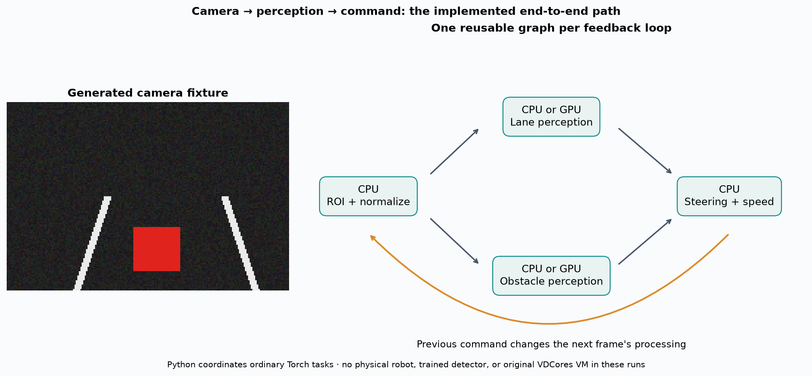
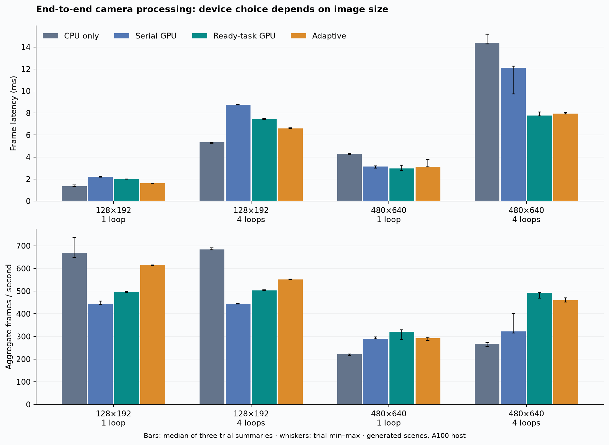
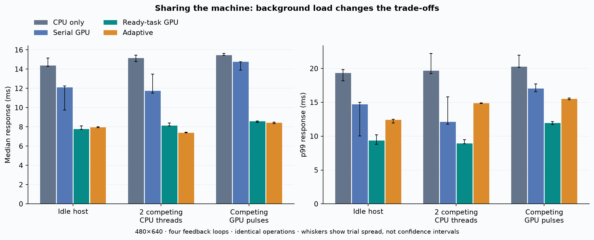
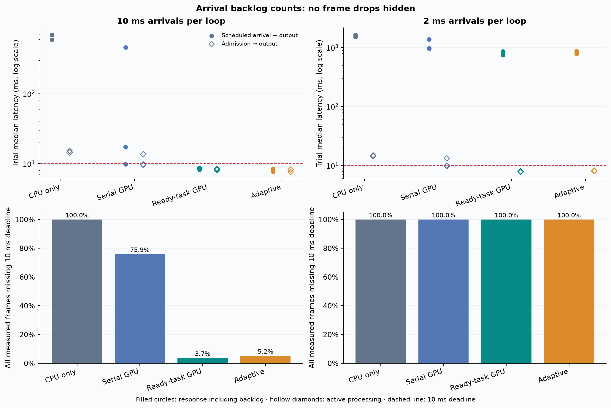
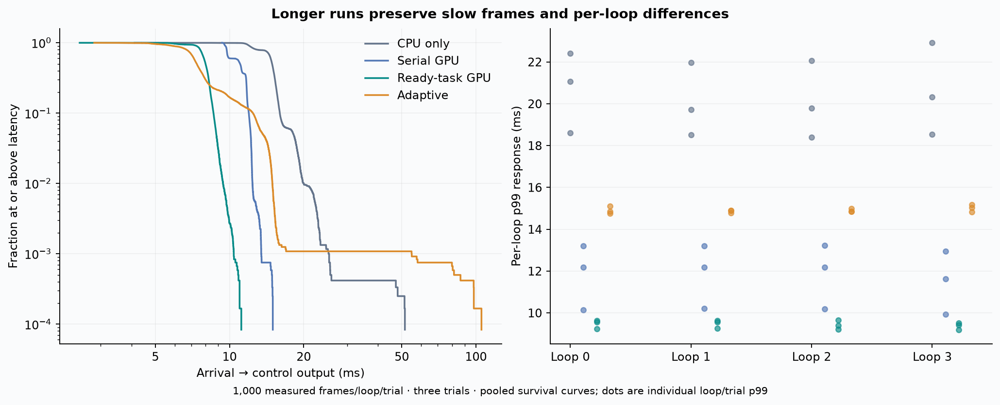
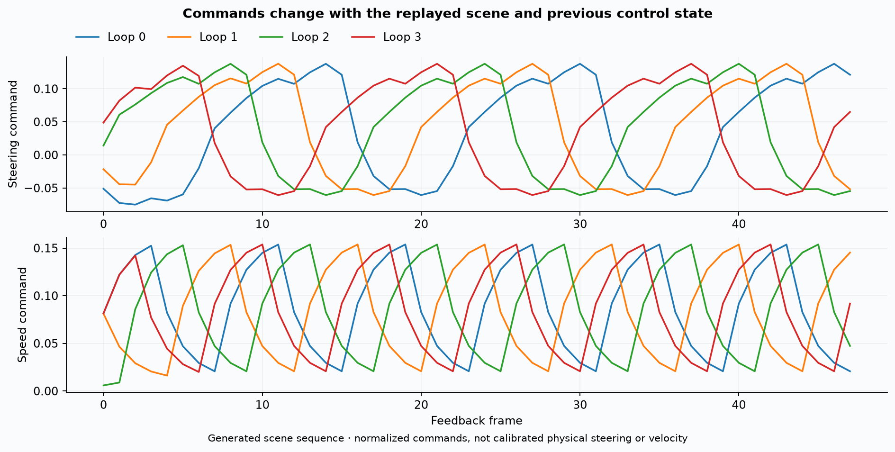
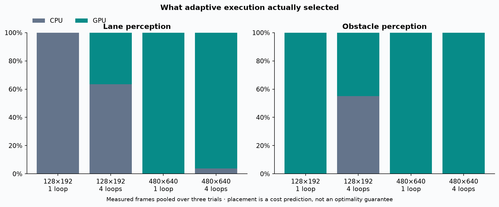

# Camera-control task graph figures

Generated-scene A100 experiments; ordinary Torch execution, not the original VDCores GPU VM.

## Camera Pipeline

The implemented path and generated scene fixture; this is software-in-the-loop, not real-world autonomy.

[Editable SVG](camera_pipeline.svg)

## Method Comparison

All four idle-host configurations. Bars are medians of three trial summaries; whiskers span trials.

[Editable SVG](method_comparison.svg)

## Background Load

Matched 480×640/four-loop comparisons with explicit CPU or GPU competing work. p99 from 200-frame trials is coarse.

[Editable SVG](background_load.svg)

## Periodic Deadlines

Scheduled arrival latency includes backlog; active processing latency is separate. Dots show individual trial medians; miss fractions pool all measured frames. Every frame is retained.

[Editable SVG](periodic_deadlines.svg)

## Tail Latency

12,000 measured frames per method across three trials. Pooled curves and individual per-loop/trial p99 preserve slow observations.

[Editable SVG](tail_latency.svg)

## Feedback Commands

Stateful commands from actual recorded experiment outputs, not an illustrative trajectory or physical robot trace.

[Editable SVG](feedback_commands.svg)

## Adaptive Decisions

Actual CPU/GPU task decisions. A high GPU selection rate does not by itself establish a performance benefit.

[Editable SVG](adaptive_decisions.svg)

[Trial summary data](summary.json). Regenerate with `python tools/plot_camera_control.py`.
