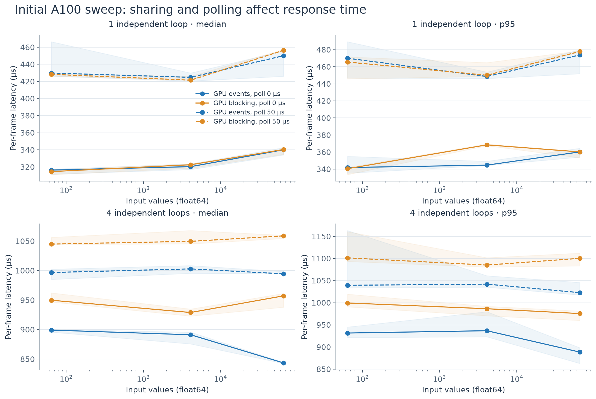
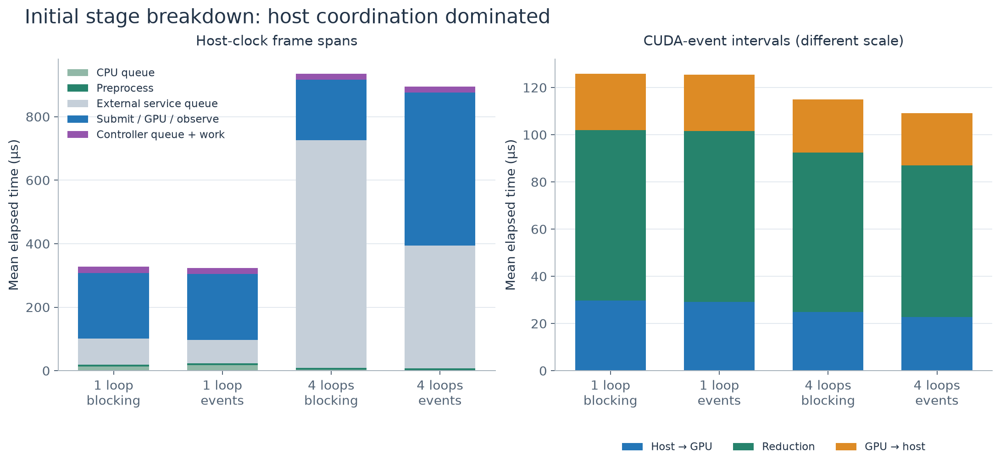
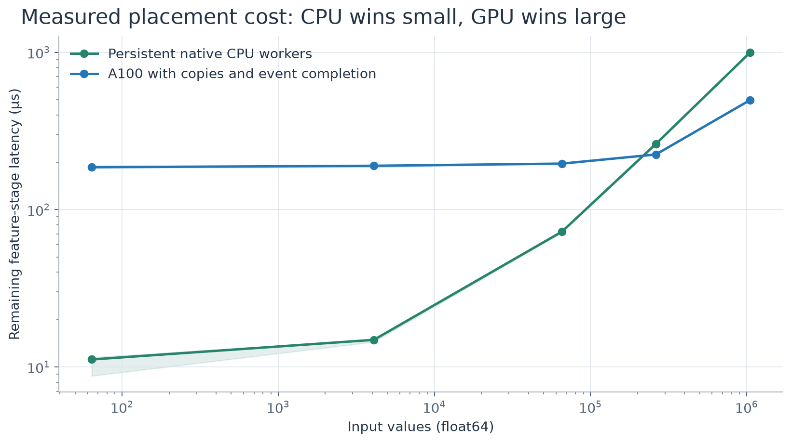
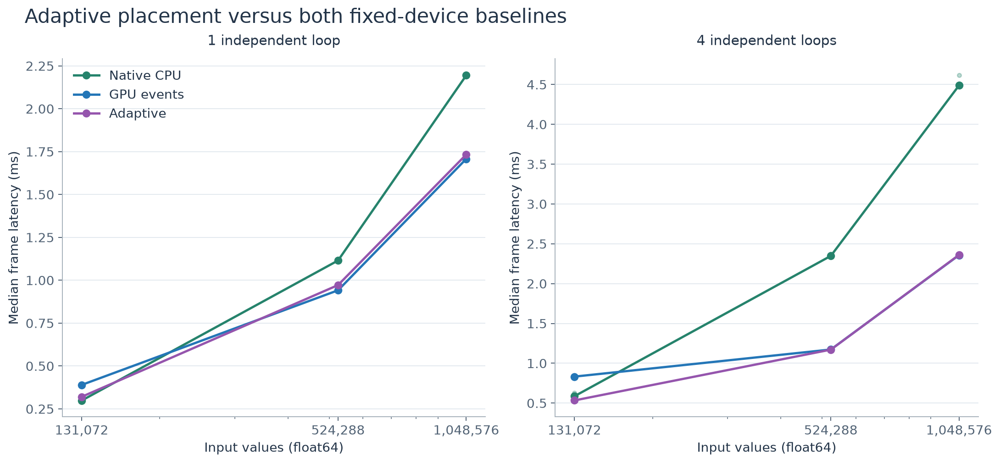
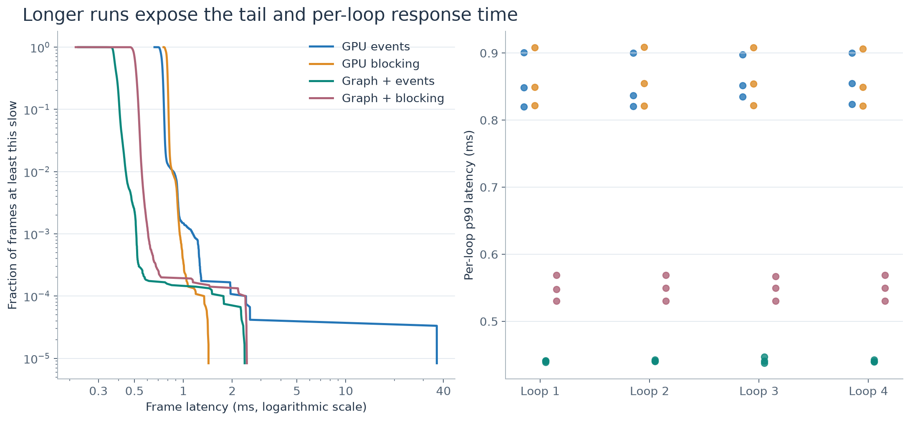
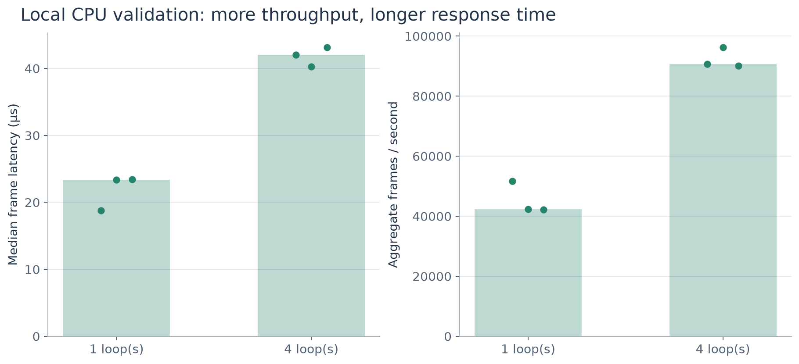
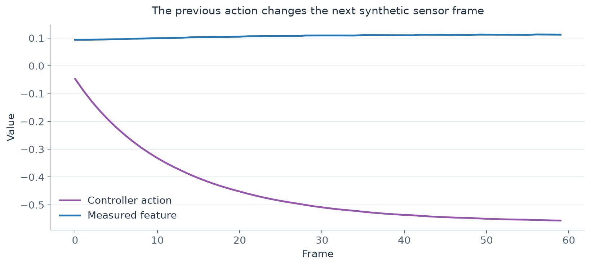
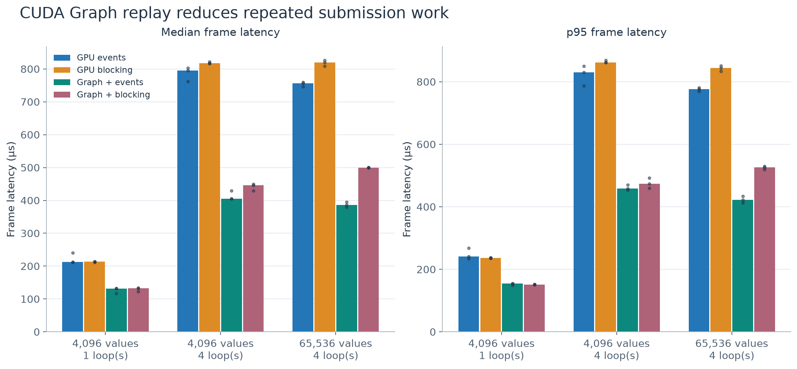
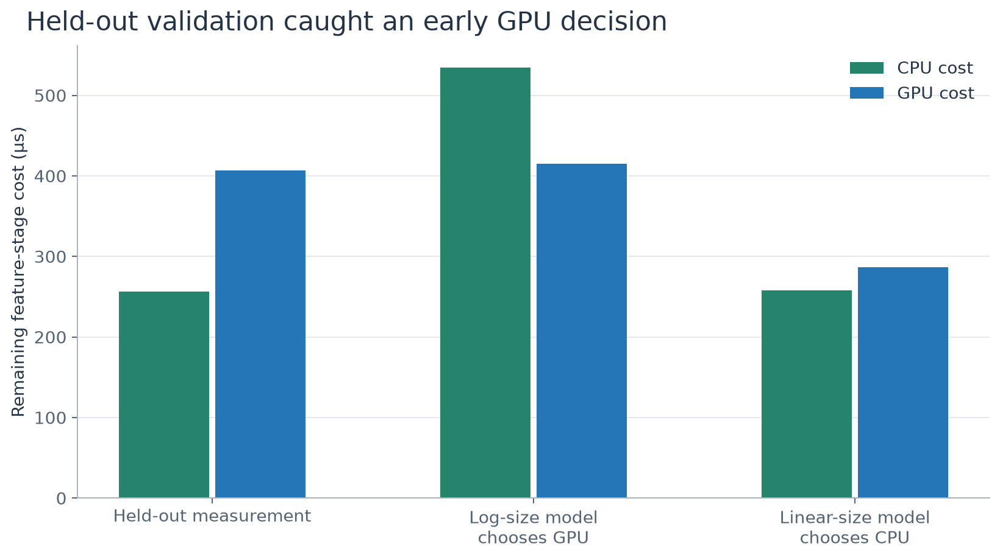
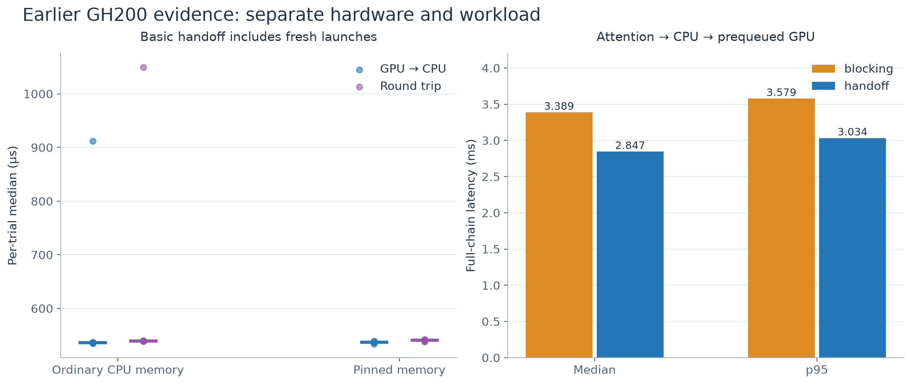

# VDCores experiment figures

Generated from recorded measurements by `tools/plot_embedded_results.py`. PNG and editable SVG files are included. Trial spread, sample counts, hardware, and limitations are stated below each plot.

## A100 Event Sweep

Initial implementation, before the zero-time condition-variable poll fix. Median of three trial summaries; shading is their min/max range, not a confidence interval. Each trial has 300 measured frames per loop. Different curves show requested polling intervals.

## A100 Stage Breakdown

Initial implementation before the zero-time poll fix and graph replay: 4,096 values, poll 0 µs, three trials. Means of individual frame spans add to the mean total. GPU event intervals include work captured between events and are shown on a separate scale; host overhead is not a kernel-latency measurement.

## A100 Placement Calibration

Same-host single-loop calibration, three trials per device and size. Cost includes dispatch, queueing, transfers and completion observation. This is not raw GPU kernel time; curves connect measurements and do not establish an exact crossover.

## A100 Adaptive Placement

Three independent trials; points are trial medians and lines show their median. 131,072 and 524,288 values are held out from the calibration grid; 1,048,576 is a calibrated endpoint. All methods execute the same feedback workload. Adaptive logging/selection overhead remains included.

## A100 Tail Latency

65,536 values and four loops, 10,000 measured frames per loop in each of three trials per mode. Left pools raw latency samples for the empirical survival curve; right shows each trial's per-loop p99. Pooling is descriptive and not a confidence interval.

## Local Cpu Validation

Apple M4 Pro, real CPU reference execution, no CUDA. Three trials; 4,096 values, two native workers. Dots show individual trials. These numbers are not a GPU comparison.

## Feedback Trace

First 60 actual frames of one local loop, including warmup. Every feature/action is checked against an independent reference, rather than merely checking that a counter advances.

## A100 Cuda Graph Replay

Same native graph, buffers, reductions, and copies. Four transports are run in alternating trial order. Bars are medians of trial summaries; dots are the individual trials. Graph replay has one whole-replay timing interval, so it is not assigned fictitious H2D/kernel/D2H substage timings.

## Placement Model Validation

262,144 values, one loop. Both predictions use the same original four calibration sizes, excluding this held-out size. Bars show the measured stage cost or its estimate. Linear interpolation corrects this CPU/GPU decision, but neither model perfectly predicts both costs; later calibration adds denser samples.

## Historical Gh200

September 21–22 archived GH200 results. The first plot retains the transient outlier; the second uses the final 1,000-iteration attention-chain run. These launch-inclusive coherent-handoff results cannot be directly compared with the new A100 synthetic loop.
